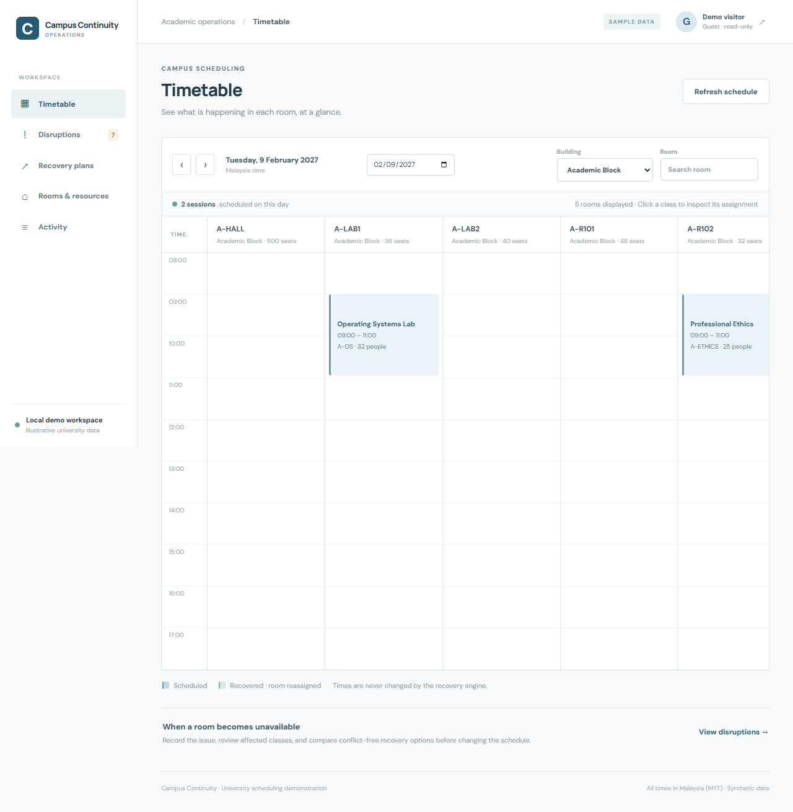

# Campus Continuity Engine

**Explainable university disruption impact and room-recovery decision support (MVP).**

A room closure, internet outage or equipment failure can disrupt several campus classes. A conventional ticket tracker records the problem but does not solve scheduling conflicts. Campus Continuity Engine finds genuinely affected sessions, evaluates replacement rooms, generates and ranks up to three **complete conflict-free recovery plans**, and applies an administrator-approved plan in a single database transaction.

This is a **local synthetic-data portfolio project**, not deployed university software. It does not use machine learning or generative AI.

**[Read the engineering case study](docs/PORTFOLIO_CASE_STUDY.md)** · [Ranked recovery alternatives](docs/screenshots/portfolio-ranked-options.png) · [Readable approval history](docs/screenshots/portfolio-audit-history.png)

## What makes this different

The value is not a dashboard of metrics: it is an explainable, **multi-session recovery workflow** with database-enforced no-double-booking guarantees. Repeated searches reuse current proposals instead of inserting identical alternatives; old records remain available for audit. Tied rankings are explicitly shown as ties, and approval history uses actual class/room names rather than unexplained numeric IDs.

## Workflow

Report incident → identify affected classes → evaluate room constraints → solve all impacted sessions together → explain feasibility and scoring → approve → update schedule atomically → audit every decision.

## Features

- Three disruption types: room/building closure, network outage and quantity-specific equipment unavailability.
- 3 synthetic buildings, 14 rooms, 24 dated sessions and four reproducible incident scenarios.
- Room capacity, inventory, connectivity, existing bookings and maintenance checks.
- Half-open time intervals: a class ending at 11:00 does not overlap one beginning at 11:00.
- Deterministic, exact bounded backtracking for simultaneous room assignments; up to three ranked **complete** plans.
- Hard-constraint rejections with concrete explanations; transparent soft-score breakdown.
- Separate sign-in and staff self-registration. Staff accounts are intentionally read-only; only locally provisioned administrators can submit or approve recovery actions.
- Argon2 password hashes, expiring signed JWT and server-enforced role restrictions.
- Atomic approvals with stale proposal checks, ordered row locks, PostgreSQL exclusion constraint and audit trail.
- Deduplicated current proposals with idempotent, serialized generation; no deletion of historical plan records.
- Honest ranking labels for equal preference scores, clear hard-constraint explanations and readable approval history with guest-safe actor labels.
- Schedule-first React workspace with a **room-by-time calendar**, date/building filters, class details, Disruptions, Recovery Plans, Rooms & Resources and Activity. Includes a dedicated auth portal and no-login read-only exploration.
- Browser-test-generated incidents are preserved in audit history but moved out of the primary case queue.
- Database-backed API responses; no hardcoded incident/plan results in the UI.

## Stack

| Layer | Stack |
|---|---|
| Frontend | React 19, TypeScript, Vite, responsive CSS |
| Backend | Python, FastAPI, Pydantic, SQLAlchemy |
| Database | PostgreSQL 18 local fallback / PostgreSQL 16 Docker packaging; Alembic migrations |
| Security | Argon2 via pwdlib, PyJWT |
| Tests | Pytest, real PostgreSQL transactions, Vitest, Playwright using Google Chrome |
| Organization | Modular monolith, separate frontend/backend |

## Verified Windows local startup

The isolated local PostgreSQL workflow is used because Docker Desktop's Linux engine returned HTTP 500 and Docker Hub DNS failures on the original workstation. The PostgreSQL 18 installation is already available and runs a **project-local cluster** in the ignored .local-runtime/postgres18 folder on 127.0.0.1:5440. This approach does not touch any other project's database.

Prerequisites: Python 3.14, Node.js, PostgreSQL 18 installed at C:\Program Files\PostgreSQL\18, Git, and Chrome for browser tests.

1. In the project root, create a private .env file from .env.example if it is not already present. Choose a strong POSTGRES_PASSWORD, a random SECRET_KEY at least 32 characters long, and DEMO_ADMIN_PASSWORD at least 12 characters. The current local project already contains a private ignored .env. **Do not commit or share it.**
2. One-time dependency installation:

~~~powershell
py -3.14 -m venv backend\.venv
backend\.venv\Scripts\python.exe -m pip install -r backend\requirements.txt
cd frontend
npm.cmd ci
cd ..
~~~

3. **Start everything with one command** from the project root:

~~~powershell
powershell.exe -NoProfile -ExecutionPolicy Bypass -File .\scripts\start-campus.ps1
~~~

The script starts or reuses the isolated PostgreSQL 18 cluster, then launches the backend and Vite in persistent independent local processes, checks both HTTP endpoints and opens the login page in Chrome. It requires no Docker or ChatGPT. Run with `-NoBrowser` to skip opening Chrome. Logs and process IDs are stored in the Git-ignored `.local-runtime` folder.

4. **Stop the application safely** (stops only app processes tracked by our startup script, leaves PostgreSQL running):

~~~powershell
powershell.exe -NoProfile -ExecutionPolicy Bypass -File .\scripts\stop-campus.ps1
~~~

To stop this project's PostgreSQL cluster too, use `stop-campus.ps1 -IncludeDatabase`. This stops **only** the cluster at `.local-runtime/postgres18`; no files are deleted. Processes launched manually rather than by `start-campus.ps1` are deliberately not terminated.

Services continue running after the launcher exits while your Windows session remains active. After a Windows restart, run the startup command again.

Open:
- Web application: http://127.0.0.1:5173
- API health: http://127.0.0.1:8000/api/health
- Swagger/OpenAPI: http://127.0.0.1:8000/docs

To explore without an account, click **Explore sample timetable**. Select **Create a staff account** to register an email/password (12+ characters); Staff is read-only. For full administrator recovery actions, sign in with **DEMO_ADMIN_USERNAME** and **DEMO_ADMIN_PASSWORD** from your own ignored local `.env`; credentials are never printed in the repository. Public signup **cannot** grant administrator privileges.

The seed command preserves existing records and avoids adding duplicates for the fixed demo buildings/rooms/classes/incidents.

## Docker Compose alternative

The repository also contains Docker Compose packaging for PostgreSQL, FastAPI and Nginx-hosted React. The Docker build was **not verified on the current computer** due to Docker engine and external registry connectivity failures. If Docker is healthy elsewhere:

~~~powershell
docker compose up -d --build
docker compose exec api alembic upgrade head
docker compose exec api python -m app.seed
~~~

Docker uses a separate PostgreSQL volume. Set private .env values first.

## Tests

The backend test runner initializes and resets **only the isolated continuity_test database**. It never truncates the main demo database:

~~~powershell
powershell.exe -NoProfile -ExecutionPolicy Bypass -File .\scripts\test-backend.ps1
cd frontend
npm.cmd run build
npm.cmd test
npm.cmd run test:e2e -- --workers=1
~~~

Playwright uses installed Google Chrome and saves real screenshots to `docs/screenshots/`. Browser tests create synthetic staff users and additional test incidents in the main demo database without resetting the baseline. Test-only incidents are kept in an expandable history section, not the primary queue. See `docs/TESTING.md` for actual run results.

## Interface design references

The original screen layout and interaction flow are **informed by real scheduling products**, including [Skedda's booking calendar](https://www.skedda.com/platform/booking-calendar) (room-grid view and date/space filtering) and [TimeEdit's academic scheduling platform](https://timeedit.com/platform/scheduling/viewer) (academic timetables). All code, branding, structure and visual styling in this repository are independent implementations, not copied proprietary UI assets. The timetable is the default screen rather than a decorative KPI dashboard.

## Engineering documentation

- [Architecture](docs/ARCHITECTURE.md)
- [ERD and relationships](docs/ERD.md)
- [Constraint solver](docs/SOLVER.md)
- [Demo scenarios](docs/DEMO.md)
- [Test execution evidence](docs/TESTING.md)
- [Portfolio CV description](docs/CV.md)
- [Product and engineering case study](docs/PORTFOLIO_CASE_STUDY.md)

## Scope and limitations

Class start/end times remain unchanged; only their room may change. Individual dated sessions are supported rather than a recurring academic timetabling engine. For computational safety, the solver explicitly rejects more than **six affected sessions** or a search exceeding **25,000 nodes**; it does not silently claim optimality. Read-only APIs are public for this **local demonstration**, while writes require admin login. Browser localStorage is used for the educational demo JWT and is not presented as production-grade session security.

No enterprise scaling, student privacy integration, SSO, notifications, ML, chatbot, mobile app or real university rollout is claimed.

## Privacy and publication

All campus data is synthetic. Ignore rules exclude .env, node_modules, Python virtual environments, database files, logs and test caches. Local Git commits do **not** imply public GitHub publication. No public repository, online deployment, or secret sharing is authorized.
